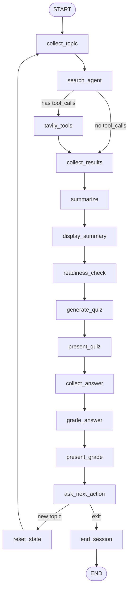

# HealthBot — AI-Powered Patient Education System

A chatbot that teaches patients about a medical condition, then quizzes them to check they actually
understood it.

Built with **LangGraph**. Ask it about any health topic, and it searches real medical websites,
rewrites what it finds in plain English, asks you one question about it, and grades your answer with
quotes from the material you just read.

---

## Table of contents

- [The assignment](#the-assignment)
- [What HealthBot does](#what-healthbot-does)
- [Sample output](#sample-output)
- [Repository structure](#repository-structure)
- [Quick start](#quick-start)
- [How it works](#how-it-works)
- [Tech stack](#tech-stack)
- [Design decisions](#design-decisions)
- [How the rubric is satisfied](#how-the-rubric-is-satisfied)
- [Documentation](#documentation)
- [Limitations](#limitations)

---

## The assignment

This is a capstone project. The scenario: you're a Healthcare AI Specialist at a (fictional) company
called **MediTech Solutions**. Patients often leave appointments without really understanding their
diagnosis or their treatment plan. That leads to missed medications, avoidable readmissions and
worse outcomes.

The brief is to build a prototype **HealthBot** — a LangGraph workflow that gives patients reliable,
on-demand health information and then checks whether they understood it.

The required workflow, straight from the brief:

| # | Step |
| --- | --- |
| 1 | Ask the patient what health topic they want to learn about |
| 2 | Search for current medical information using the Tavily search tool |
| 3 | Summarize those results in patient-friendly language |
| 4 | Show the summary and let the patient read it |
| 5 | Wait for the patient to say they're ready for a comprehension check |
| 6 | Generate one quiz question from the summary |
| 7 | Show the quiz question |
| 8 | Collect the patient's answer |
| 9 | Grade it, with a justification that cites the summary |
| 10 | Show the grade and feedback |
| 11 | Ask whether they want a new topic or to exit |
| 12 | Loop back (resetting state for privacy) or end the session |

All twelve steps are implemented in [`HealthBot.ipynb`](HealthBot.ipynb).

## What HealthBot does

The single most important rule in this build: **the bot never tells the patient anything it can't
trace to a source it just retrieved.**

Ask a language model "tell me about diabetes" and it answers from training data of unknown age and
provenance. HealthBot doesn't allow that. The model is only ever used to *reshape* text that came
back from a real medical website. Each stage sees less than the one before it:

| Stage | Can see | Cannot use |
| --- | --- | --- |
| Search | The patient's topic | Its own knowledge — it must call the search tool |
| Summarize | The search results only | Any fact not in those results |
| Write quiz | The summary only | Anything outside the summary |
| Grade answer | Summary + question + answer | Outside medical knowledge |

Search is also locked to nine reputable publishers — Mayo Clinic, MedlinePlus, NIH, CDC, WHO,
Cleveland Clinic, Johns Hopkins, NHS and Healthline. Not a suggestion in a prompt: the search API
physically cannot return anything else.

A useful side effect of that last row: the grader can't mark you down for missing something the
summary never told you, because the grader can't see anything the summary doesn't contain.

## Sample output

From a real session:

```
==============================================================================
COMPREHENSION CHECK
==============================================================================
What warning signs should prompt someone with type 2 diabetes to seek
immediate medical care?

Your answer: Eating well, staying active and taking medicine as prescribed
helps control blood sugar.

==============================================================================
YOUR RESULT
==============================================================================
Grade: F

Justification: The answer does not mention any of the warning signs listed in
the summary; instead it repeats general management advice. The question asked
for specific symptoms that require immediate medical attention, which the
response failed to provide.

Citations from the summary:

- "If blood sugar becomes extremely high, a life-threatening situation called
  hyperosmolar hyperglycemic state ... can develop."

- "Very low blood sugar, severe infections, wounds that do not heal, or sudden
  changes in vision are also warning signs that need prompt medical attention."
```

The citations are the point. The patient sees the exact sentence they should have drawn on, so a bad
grade still teaches something.

## Repository structure

| File | What it is |
| --- | --- |
| [`HealthBot.ipynb`](HealthBot.ipynb) | **The project.** State, prompts, 15 nodes, edges, the graph, and the interactive run cell |
| [`docs/HLD.md`](docs/HLD.md) | High Level Design — architecture, data flow, technology rationale, design decisions, limitations |
| [`docs/LLD.md`](docs/LLD.md) | Low Level Design — state schema, per-node contracts, routing, prompts, message lifecycle, verification log |
| [`requirements.txt`](requirements.txt) | Python dependencies |
| [`config.env.example`](config.env.example) | Template for your API keys — copy it to `config.env` |
| [`.gitignore`](.gitignore) | Keeps `config.env` and `.venv/` out of version control |

`config.env` holds live API keys and is **never committed**.

## Quick start

### 1. Set up the environment

```bash
pip install uv
uv venv --python 3.11.13
.\.venv\Scripts\Activate
uv pip install -r requirements.txt
```

### 2. Add your API keys

Copy [`config.env.example`](config.env.example) to `config.env` and fill in both values:

```env
OPENAI_API_KEY="sk-your_key_here"
TAVILY_API_KEY="tvly-your_key_here"
```

- **OpenAI** — https://platform.openai.com/api-keys
- **Tavily** — https://app.tavily.com/home (first 1000 searches free)

### 3. Run it

```bash
jupyter notebook HealthBot.ipynb
```

Select the kernel for your virtual environment, then run the cells top to bottom. Section 8 starts
the interactive session — type a topic, read the summary, press Enter, answer the question, and
choose `new` or `exit`.

## How it works

HealthBot is a **state machine**, not a free-running agent. The steps are fixed and declared up
front as a graph, and the model is called at exactly four points with tightly-scoped prompts.



Three concepts do all the work:

**Nodes** are small functions, each with one job. `summarize` writes a summary. `present_quiz`
prints a question. Nothing does two things.

**Edges** are the arrows — which node runs next. Two of them are conditional: one checks whether the
model actually asked to search, the other checks whether the patient wants another topic.

**State** is a shared object every node reads from and writes to. `summarize` writes
`state["summary"]`; later, `generate_quiz` reads it. Nodes never call each other directly —
everything moves through state, which is what makes the privacy reset provable rather than assumed.

Full detail lives in [`docs/LLD.md`](docs/LLD.md).

## Tech stack

| Component | Choice | Why |
| --- | --- | --- |
| Orchestration | **LangGraph** | The workflow is a fixed sequence with one loop and two branches. A declarative state machine models that directly, and makes state inspectable |
| Search | **Tavily** (LangChain community tool) | Built for LLM retrieval — returns clean passage text plus source URLs, and `include_domains` gives hard editorial control |
| Chat model | **OpenAI `gpt-4o-mini`** | Reliable tool calling and clean prose at low cost. A full topic runs for a fraction of a cent |
| Interface | **Jupyter notebook** | Required by the brief. `input()` / `print()` need zero infrastructure, and the saved notebook doubles as a record of the session |
| Temperature | **0** | Summaries and grades should be reproducible. Creative variation is a liability in patient education |

## Design decisions

**The model calls the search tool — the code doesn't.** `search_agent` binds the Tavily tool to the
model and lets the model write its own query. A conditional edge then checks for a tool call. More
work than calling Tavily directly, but it's the architecture the brief asks for, and query wording
adapts to how the patient phrased their topic.

**Retrieval is restricted at the API, not in a prompt.** Telling a model to "prefer reputable
sources" is advisory. `include_domains` makes it structural.

**Fifteen small nodes instead of five big ones.** Display is separate from generation; collecting
input is separate from processing it. Costs a few extra edges, buys testability and a graph that
reads like documentation.

**The reset is destructive on purpose.** Because the `messages` field uses LangGraph's
`add_messages` reducer, assigning a fresh list would *append* rather than replace. `reset_state`
emits one `RemoveMessage` per existing message so the reducer genuinely deletes them. Mechanics in
[`docs/LLD.md` §7](docs/LLD.md).

## How the rubric is satisfied

| Criterion | Where |
| --- | --- |
| API keys load correctly | Notebook §1 — `load_dotenv` plus assertions |
| Live calls to both services succeed | Notebook §2a smoke test |
| The model calls Tavily for search | `search_agent` + `bind_tools` + `ToolNode` |
| Model summarizes the Tavily results | `summarize` node |
| Summary uses no other knowledge | `SUMMARY_SYSTEM_PROMPT` constraints |
| Summary is 3–4 paragraphs | Prompt constraint, verified in a live run |
| Quiz built from the summary only | `generate_quiz` + `QUIZ_SYSTEM_PROMPT` |
| Quiz answerable from the summary alone | Prompt constraint |
| Grading uses only the summary | `grade_answer` + `GRADER_SYSTEM_PROMPT` |
| Letter grade plus justification | Fixed grader output contract |
| State class read and updated by nodes | `HealthBotState`, [LLD §2](docs/LLD.md) |
| Later nodes see earlier nodes' state | Producer→consumer map, [LLD §2](docs/LLD.md) |
| Model has access to previous messages | Message lifecycle, [LLD §6](docs/LLD.md) |
| Multiple single-responsibility nodes | Node contracts, [LLD §3](docs/LLD.md) |
| Edges drive a sequential workflow | Routing, [LLD §4](docs/LLD.md) |
| Restart or exit after the grade | `ask_next_action` → `reset_state` or `end_session` |
| State reset when restarting | Reset mechanics, [LLD §7](docs/LLD.md) |
| Whole workflow runs end to end | Verified with a scripted two-topic session |

## Documentation

| Document | Covers |
| --- | --- |
| [High Level Design](docs/HLD.md) | Purpose and scope, context and architecture diagrams, layered component breakdown, data flow, technology rationale, five key design decisions, privacy and cost characteristics, seven known limitations, future work |
| [Low Level Design](docs/LLD.md) | Notebook section map, state schema and field ownership, per-node contracts, routing tables, prompt specifications, message lifecycle, reset mechanics, error handling matrix, verification log, rubric traceability |

## Limitations

This is a prototype, and it's worth being clear about what it isn't:

- **Not medical advice.** It gives general education, never a diagnosis or a personal treatment plan,
  and every summary ends by telling the patient to talk to their own provider
- **No retry on API failure.** A rate limit or network blip ends the session
- **One patient at a time.** `input()` blocks, so this can't be served over HTTP as written
- **Nothing is saved.** No database, no logs — good for privacy, but a crash loses the session
- **One quiz question** is a thin measure of comprehension
- **English only**, and text-only output with no accessibility layer

Each of these is covered with a mitigation path in [`docs/HLD.md` §10](docs/HLD.md).
