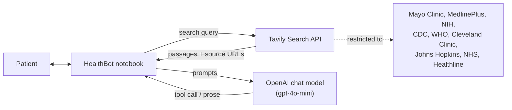
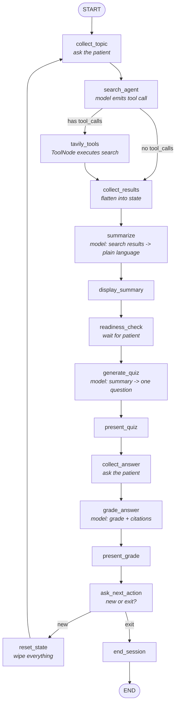
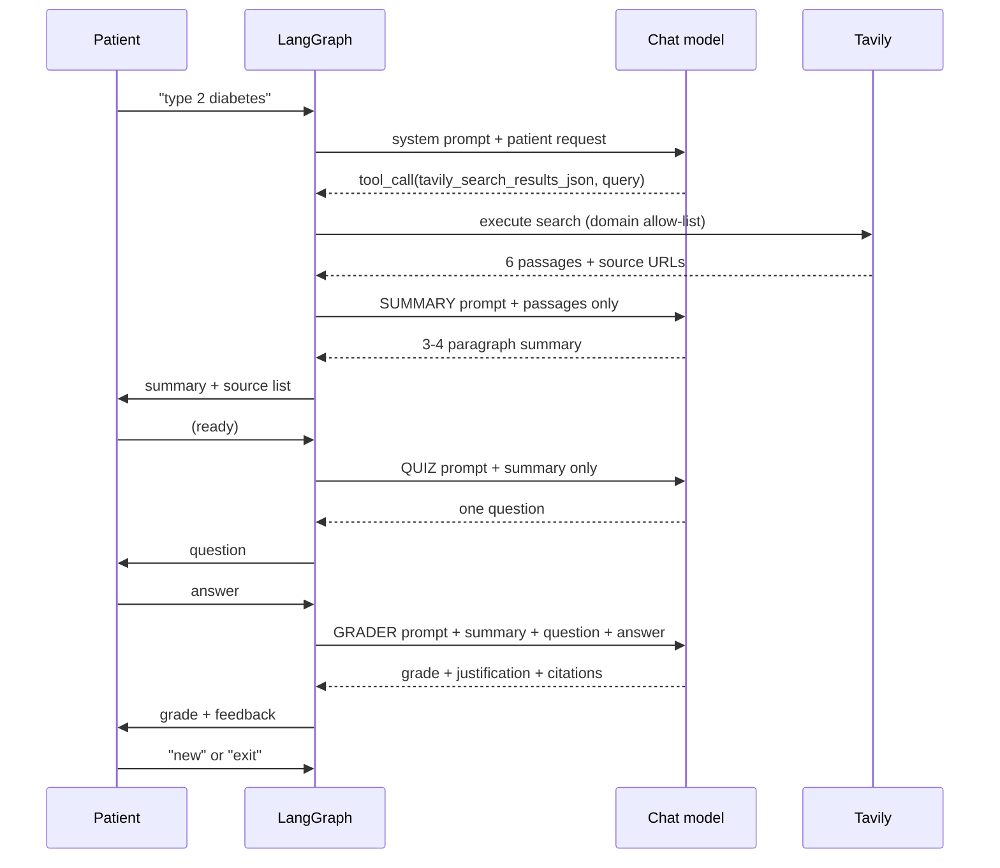

# HealthBot — High Level Design (HLD)

**Project:** AI-Powered Patient Education System
**Client (scenario):** MediTech Solutions
**Document type:** High Level Design
**Version:** 1.0

---

## 1. Purpose

HealthBot is a conversational patient-education prototype. A patient names a health topic; the
system retrieves current information from reputable medical publishers, rewrites it in plain
language, checks the patient's comprehension with a single quiz question, and grades the answer with
citations back to the material they just read.

The design goal that shapes every decision below: **the patient must never be shown a fact the
system cannot trace to a retrieved source.** A general-purpose language model asked "tell me about
diabetes" will answer from training data of unknown age and provenance. HealthBot forbids that. The
model is used only to *transform* retrieved text, never to *supply* medical content.

## 2. Scope

**In scope**

- Single-patient, single-session, console-style interaction inside a Jupyter notebook
- Retrieval restricted to an allow-list of reputable medical domains
- Summarization, one-question comprehension check, and graded feedback with citations
- Multi-topic sessions with a full state reset between topics

**Out of scope**

- Persistence of any kind (no database, no session store, no logging of patient input)
- Authentication, multi-user support, or concurrency
- Personalization from patient records, diagnosis, or treatment recommendation
- Production deployment, web UI, or API surface

## 3. Context



The system has exactly two external dependencies — a search API and a chat-model API. Everything
else runs locally in the notebook process.

## 4. Architecture overview

HealthBot is a **LangGraph state machine**. There is no free-running agent loop: the sequence of
steps is fixed and declared as a graph, and the model is invoked at four specific points with
tightly-scoped prompts.



### Layers

| Layer | Responsibility | Realized as |
| --- | --- | --- |
| **Presentation** | Ask questions, render text | `collect_topic`, `display_summary`, `readiness_check`, `present_quiz`, `collect_answer`, `present_grade`, `ask_next_action`, `end_session` |
| **Orchestration** | Sequencing, branching, looping, state | LangGraph `StateGraph`, two conditional routers, `reset_state` |
| **Reasoning** | Summarize, question, grade | `summarize`, `generate_quiz`, `grade_answer` — model calls with fixed system prompts |
| **Retrieval** | Fetch source material | `search_agent` (decides) + `tavily_tools` (executes) + `collect_results` (normalizes) |

Presentation nodes never call the model. Reasoning nodes never call `input()` or `print()` patient
content. This separation is deliberate: it makes each node trivially testable and keeps the graph
readable as a workflow rather than a tangle.

## 5. Data flow



**Grounding chain.** Note what each model call is allowed to see:

| Call | Input | Explicitly forbidden |
| --- | --- | --- |
| Search | Patient's topic | Answering from memory — must emit a tool call |
| Summarize | Tavily passages only | Any fact not in the passages |
| Quiz | Summary only | Anything outside the summary |
| Grade | Summary + question + answer | Outside medical knowledge; penalizing what the summary never said |

Each stage narrows. The grader cannot mark a patient wrong for missing something the summary never
told them, because the grader cannot see anything the summary does not contain.

## 6. Technology choices

| Choice | Rationale |
| --- | --- |
| **LangGraph** | The workflow is a fixed sequence with a loop and two branches — a declarative state machine models it directly. State is explicit and inspectable, which makes the privacy reset provable rather than assumed. |
| **Tavily** (LangChain community tool) | Purpose-built search-for-LLMs API returning clean passage text plus source URLs. `include_domains` gives hard editorial control over what can be retrieved. |
| **OpenAI `gpt-4o-mini`** | Reliable tool calling and clean prose at low cost and latency. Provider-swappable — see §9. |
| **Jupyter notebook** | Mandated by the brief. `input()` / `print()` give a zero-infrastructure conversational surface, and the saved notebook doubles as an execution record. |
| **`temperature=0`** | Summaries and grades should be reproducible. Creative variation is a liability in patient education. |

## 7. Key design decisions

**D1 — The model calls the search tool; the code does not.**
`search_agent` binds the Tavily tool to the model and lets the model formulate the query and emit the
call. A conditional edge routes on the presence of `tool_calls`. This is more work than calling
Tavily directly, but it is the architecture the brief specifies, and it means query formulation
adapts to how the patient phrased their topic.

**D2 — Retrieval is domain-restricted at the API boundary, not by prompt.**
Asking a model to "prefer reputable sources" is advisory. `include_domains` makes it structural —
Tavily physically cannot return a result from outside the nine allow-listed publishers.

**D3 — Every node has one responsibility.**
Fifteen small nodes rather than five large ones. Display is separate from generation; input
collection is separate from processing. This costs a few extra edges and buys testability and a
graph that reads as documentation.

**D4 — State reset is destructive and explicit.**
`reset_state` does not merely overwrite fields. Because `messages` uses the `add_messages` reducer,
assigning a new list would *append*, not replace. The node emits one `RemoveMessage` per existing
message so the reducer deletes them. See LLD §7 for the mechanics.

**D5 — Reset runs on the loop edge, not on exit.**
The requirement is that a new topic starts clean. After the final topic the state still holds that
topic — which is what lets the notebook demonstrate that state management worked at all. Adding a
wipe on exit would be trivial if a deployment required it.

## 8. Non-functional characteristics

**Privacy.** Nothing is written to disk. No database, no log file, no telemetry. Patient answers
live in process memory only, and are destroyed by `reset_state` when the topic changes. The only
data leaving the machine is the topic string (to Tavily) and the retrieved passages plus patient
answer (to the model provider) — a real deployment would need a BAA or self-hosted inference before
handling identifiable information.

**Cost and latency.** Four model calls and one search per topic. A full topic costs a fraction of a cent and completes in roughly 10–20 seconds, dominated by Tavily's `advanced`
search depth and summary generation.

**Reliability.** Both providers enforce rate limits. Normal interactive use stays far below them; a
rapid re-run loop can trigger HTTP 429, which surfaces as an exception from the affected node.
Retry/backoff is not implemented — see §10.

**Correctness of medical content.** Bounded, not guaranteed. Retrieval is restricted to reputable
publishers and the summarizer is instructed to add nothing, but summarization can still lose nuance.
Every summary ends with an instruction to consult a clinician, and the system never diagnoses or
recommends a personal treatment plan.

## 9. Portability

The provider is isolated to two lines in notebook section 2. Because LangChain normalizes
`.invoke()` and `.bind_tools()` across providers, the graph, state, nodes, prompts, and edges are
provider-independent.

```python
# Current
from langchain_openai import ChatOpenAI
llm = ChatOpenAI(model="gpt-4o-mini", temperature=0)

# Any other provider, e.g. Groq
from langchain_groq import ChatGroq
llm = ChatGroq(model="openai/gpt-oss-120b", temperature=0)
```

Any substitute must support tool calling, or decision D1 breaks.

## 10. Known limitations

| # | Limitation | Impact | Mitigation if productionized |
| --- | --- | --- | --- |
| L1 | No retry on API failure | A 429 or network blip aborts the session mid-topic | Wrap model/tool calls in bounded retry with backoff |
| L2 | Blocking `input()` inside nodes | Cannot be served over HTTP; one patient at a time | Replace with LangGraph `interrupt()` + checkpointer |
| L3 | No conversation persistence | A crash loses the session | Add a checkpointer (deliberately omitted here for privacy) |
| L4 | Single quiz question | Weak measurement of comprehension | Question bank, difficulty adaptation, spaced repetition |
| L5 | Retrieval quality varies by topic | Rare conditions may return thin or research-grade passages | Add a relevance-check node; widen the allow-list per specialty |
| L6 | English only | Excludes many patients | Add a language field to state; translate prompts and output |
| L7 | No accessibility layer | Text-only console output | Screen-reader-friendly UI, adjustable reading level |

## 11. Future work

Short term: retry/backoff (L1), a multi-question quiz with a running score, and a "explain that
differently" path when a patient scores poorly. Medium term: replace the notebook surface with
LangGraph `interrupt()` so the same graph can serve a web front end unchanged (L2). Longer term:
clinician-reviewed content sets for high-volume conditions, so retrieval falls back to vetted
material rather than live search.

---

*See [LLD.md](LLD.md) for state schema, per-node contracts, routing tables, prompt specifications
and message lifecycle. Back to the [project README](../README.md).*
