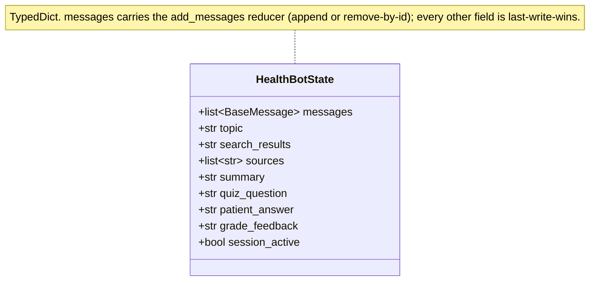
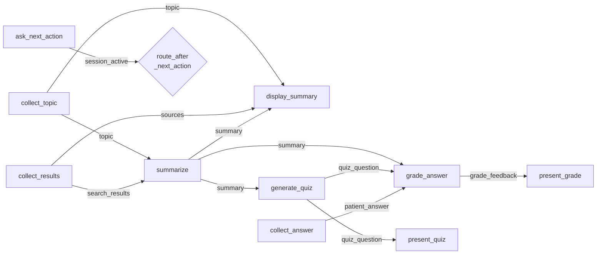
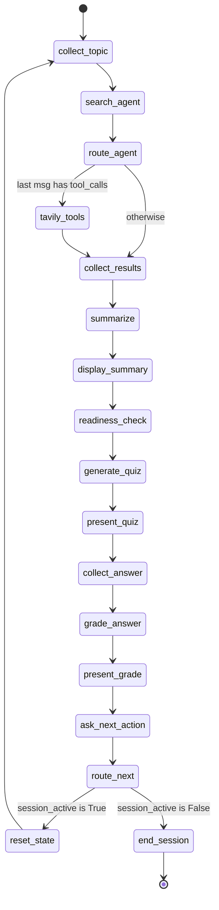
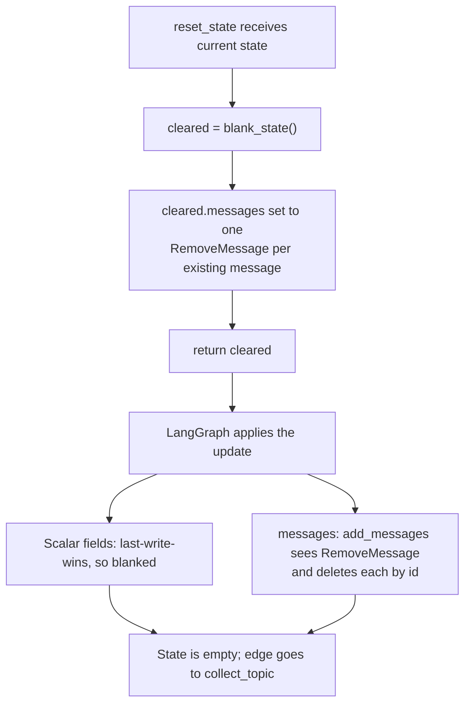

# HealthBot — Low Level Design (LLD)

**Document type:** Low Level Design
**Companion to:** [HLD.md](HLD.md)
**Implementation:** [`HealthBot.ipynb`](../HealthBot.ipynb)
**Version:** 1.0

---

## 1. Notebook section map

| Section | Contents | Defines |
| --- | --- | --- |
| 1 | Environment & keys | `load_dotenv`, key assertions |
| 2 | Model and tools | `MEDICAL_DOMAINS`, `tavily_tool`, `CHAT_MODEL`, `llm`, `llm_with_tools` |
| 2a | Smoke test | Live proof both APIs respond and the model emits a tool call |
| 3 | State | `HealthBotState`, `blank_state()` |
| 4 | Prompts | `SEARCH_SYSTEM_PROMPT`, `SUMMARY_SYSTEM_PROMPT`, `QUIZ_SYSTEM_PROMPT`, `GRADER_SYSTEM_PROMPT` |
| — | Helpers | `banner()`, `wrap()` |
| 5 | Nodes | 14 node functions + `tavily_tool_node` |
| 6 | Routers | `route_after_agent`, `route_after_next_action` |
| 7 | Graph | `builder`, `healthbot` (compiled) |
| 8 | Run | `healthbot.invoke(blank_state(), config={"recursion_limit": 250})` |
| 9 | Verification | Post-session state inspection + direct `reset_state` demonstration |

## 2. State schema



`blank_state()` returns the zero value of every field and is used both to seed the graph and inside
`reset_state`.

### Field ownership

| Field | Type | Written by | Read by | Reducer |
| --- | --- | --- | --- | --- |
| `messages` | `list[BaseMessage]` | `collect_topic`, `search_agent`, `tavily_tools`, `summarize`, `generate_quiz`, `collect_answer`, `grade_answer`, `reset_state` | `search_agent`, `collect_results`, `route_after_agent`, `reset_state` | `add_messages` |
| `topic` | `str` | `collect_topic`, `reset_state` | `summarize`, `display_summary` | overwrite |
| `search_results` | `str` | `collect_results`, `reset_state` | `summarize` | overwrite |
| `sources` | `List[str]` | `collect_results`, `reset_state` | `display_summary` | overwrite |
| `summary` | `str` | `summarize`, `reset_state` | `display_summary`, `generate_quiz`, `grade_answer` | overwrite |
| `quiz_question` | `str` | `generate_quiz`, `reset_state` | `present_quiz`, `grade_answer` | overwrite |
| `patient_answer` | `str` | `collect_answer`, `reset_state` | `grade_answer` | overwrite |
| `grade_feedback` | `str` | `grade_answer`, `reset_state` | `present_grade` | overwrite |
| `session_active` | `bool` | `collect_topic`, `ask_next_action`, `reset_state`, `end_session` | `route_after_next_action` | overwrite |

### Producer → consumer dependencies



No node reads a field that a prior node has not written. This is what the rubric means by
"subsequent nodes can access state data set by previous nodes."

## 3. Node contracts

Every node has the signature `(state: HealthBotState) -> dict` and returns **only** the keys it
changes. Returning `{}` means "no state change" — used by pure-display nodes.

| # | Node | Reads | Writes | I/O | Model call |
| --- | --- | --- | --- | --- | --- |
| 1 | `collect_topic` | — | `topic`, `session_active`, `messages` | `input()` | — |
| 2 | `search_agent` | `messages` | `messages` | — | `llm_with_tools` |
| 3 | `tavily_tools` | `messages` | `messages` | — | — (executes tool) |
| 4 | `collect_results` | `messages` | `search_results`, `sources` | `print()` status | — |
| 5 | `summarize` | `topic`, `search_results` | `summary`, `messages` | — | `llm` |
| 6 | `display_summary` | `topic`, `summary`, `sources` | — | `print()` | — |
| 7 | `readiness_check` | — | — | `input()` | — |
| 8 | `generate_quiz` | `summary` | `quiz_question`, `messages` | — | `llm` |
| 9 | `present_quiz` | `quiz_question` | — | `print()` | — |
| 10 | `collect_answer` | — | `patient_answer`, `messages` | `input()` | — |
| 11 | `grade_answer` | `summary`, `quiz_question`, `patient_answer` | `grade_feedback`, `messages` | — | `llm` |
| 12 | `present_grade` | `grade_feedback` | — | `print()` | — |
| 13 | `ask_next_action` | — | `session_active` | `input()` | — |
| 14 | `reset_state` | `messages` | all fields | `print()` status | — |
| 15 | `end_session` | — | `session_active` | `print()` | — |

Four model calls per topic: nodes 2, 5, 8, 11.

### Notable implementations

**`collect_topic`** — loops on empty input so the graph cannot proceed without a topic. Seeds
`messages` with the search system prompt and the patient's request.

**`search_agent`** — one line of substance: `llm_with_tools.invoke(state["messages"])`. The model
formulates the query; the code does not.

**`collect_results`** — walks `messages` backwards, stopping at the first `HumanMessage` (the start
of the current topic), collecting `ToolMessage` objects. The collected list is then reversed to
restore chronological order *before* flattening, so passages and their URLs stay aligned. Tavily's
payload arrives as a JSON string; a `JSONDecodeError` fallback wraps raw text rather than crashing.
Source URLs are de-duplicated with `dict.fromkeys()` to preserve order.

**`ask_next_action`** — loops until the input is exactly `new` or `exit`, so the conditional edge
below it can never receive an ambiguous value.

## 4. Routing



| Router | Condition | Destination |
| --- | --- | --- |
| `route_after_agent` | `isinstance(last, AIMessage) and last.tool_calls` | `tavily_tools` |
| `route_after_agent` | otherwise | `collect_results` |
| `route_after_next_action` | `state["session_active"] is True` | `reset_state` |
| `route_after_next_action` | `state["session_active"] is False` | `end_session` |

The `collect_results` fallback on `route_after_agent` is a safety net: if the model answers in prose
instead of calling the tool, the graph still advances (with empty search results) rather than
hanging. With `gpt-4o-mini` and the search system prompt, the tool branch is taken every time in
testing.

## 5. Prompt specifications

| Prompt | Used by | Sees | Hard constraints |
| --- | --- | --- | --- |
| `SEARCH_SYSTEM_PROMPT` | `search_agent` | Patient's topic | Must call the tool exactly once; must not answer from own knowledge |
| `SUMMARY_SYSTEM_PROMPT` | `summarize` | Topic + Tavily passages | 3–4 paragraphs; prose only, no markdown; 6th–8th grade reading level; define every medical term on first use; no fact absent from the passages; must end with a "talk to your provider" reminder; must not diagnose |
| `QUIZ_SYSTEM_PROMPT` | `generate_quiz` | Summary only | Exactly one open-ended question; answerable from the summary alone; one sentence; output the question and nothing else |
| `GRADER_SYSTEM_PROMPT` | `grade_answer` | Summary + question + answer | Summary is the only source of truth; must not penalize omissions the summary never covered; fixed three-part output |

### Grader output contract

```
Grade: <A | B | C | D | F>

Justification: <2-4 sentences on what was right and what was missed>

Citations from the summary: <1-3 direct quotations in quotation marks>
```

The citation requirement is what turns grading into teaching — the patient sees the exact sentence
they should have drawn on, not just a verdict.

## 6. Message lifecycle

One topic accumulates exactly eight messages:

| After node | Added | Type | Running total |
| --- | --- | --- | --- |
| `collect_topic` | Search system prompt | `SystemMessage` | 1 |
| `collect_topic` | "I would like to learn about: {topic}" | `HumanMessage` | 2 |
| `search_agent` | Tavily tool call | `AIMessage` (`tool_calls`) | 3 |
| `tavily_tools` | Search results JSON | `ToolMessage` | 4 |
| `summarize` | The summary | `AIMessage` | 5 |
| `generate_quiz` | "Comprehension check question: …" | `AIMessage` | 6 |
| `collect_answer` | "My answer: …" | `HumanMessage` | 7 |
| `grade_answer` | Grade + justification + citations | `AIMessage` | 8 |

This satisfies the rubric's "the model has access to previous messages (tool calls, summary, quiz
question, etc.)" — the full chain is present in state, tool call and tool result included.

A message count of 8 after a multi-topic session is therefore direct evidence that the reset worked:
without it, two topics would leave 16.

## 7. Reset mechanics

The subtlety: `messages` uses the `add_messages` reducer, so returning `{"messages": []}` from a
node is a **no-op append**, not a clear. Deletion requires emitting a `RemoveMessage` carrying the
`id` of each message to remove.



```python
def reset_state(state: HealthBotState) -> dict:
    cleared = blank_state()
    cleared["messages"] = [RemoveMessage(id=m.id) for m in state["messages"]]
    return cleared
```

Verified in section 9 and by the end-to-end test: after a two-topic session no string from topic 1
appears anywhere in `summary`, `search_results`, or `topic`, and exactly 8 messages remain.

## 8. Tool and model configuration

| Parameter | Value | Reason |
| --- | --- | --- |
| `max_results` | `6` | Enough breadth for a 3–4 paragraph summary without exceeding context |
| `search_depth` | `"advanced"` | Fuller passage text; shallow mode returns snippets too thin to summarize |
| `include_answer` | `False` | Tavily's own synthesis would bypass our summarization prompt |
| `include_raw_content` | `False` | Full page HTML adds noise and tokens |
| `include_domains` | 9 medical publishers | Structural editorial control (HLD D2) |
| `CHAT_MODEL` | `gpt-4o-mini` | Reliable tool calling and clean prose at low cost |
| `temperature` | `0` | Reproducible summaries and grades |
| `recursion_limit` | `250` | ~14 nodes per topic; supports ~17 topics in one session |

**Allow-list:** `mayoclinic.org`, `medlineplus.gov`, `nih.gov`, `cdc.gov`, `who.int`,
`clevelandclinic.org`, `hopkinsmedicine.org`, `nhs.uk`, `healthline.com`.

## 9. Error handling

| Case | Current behaviour | Rationale |
| --- | --- | --- |
| Empty topic input | Re-prompts until non-empty | Cannot search for nothing |
| Empty quiz answer | Substitutes `"(no answer given)"` | Grader still returns feedback rather than crashing |
| Invalid next-action input | Re-prompts until `new` or `exit` | Guarantees the router gets a clean boolean |
| Tavily returns non-JSON | Wrapped as a single passage | Degrades instead of raising |
| Model answers without a tool call | Routes to `collect_results` with empty results | Graph advances rather than hanging |
| Missing API key | `AssertionError` in section 1 | Fail fast with a named key |
| Provider 429 / network error | Exception propagates, session aborts | Accepted for a prototype — HLD L1 |

## 10. Verification performed

| # | Check | Method | Result |
| --- | --- | --- | --- |
| V1 | Both API keys authenticate | Live calls to Tavily and OpenAI | Pass |
| V2 | Model emits a Tavily tool call | Inspect `AIMessage.tool_calls` | Pass |
| V3 | Graph compiles with all nodes | `get_graph()` node census | Pass — 17 incl. START/END |
| V4 | `collect_results` parses and orders passages | Synthetic `ToolMessage` fixture | Pass |
| V5 | Both routers branch correctly | Direct calls with crafted states | Pass |
| V6 | Full session, two topics, loop and exit | Scripted `input()`, real API calls | Pass |
| V7 | Summary is 3–4 grounded paragraphs | Manual read of live output | Pass |
| V8 | Grade includes letter + justification + citations | Manual read of live output | Pass — `Grade: F` with two quotations |
| V9 | No topic-1 data survives the reset | Substring assertion over final state | Pass |
| V10 | Message count equals one topic's worth | `len(final_state["messages"]) == 8` | Pass |

## 11. Rubric traceability

| Rubric criterion | Where satisfied |
| --- | --- |
| API keys loaded correctly | §1 — `load_dotenv` + assertions |
| Successful calls to both services | §2a smoke test |
| Model calls Tavily for search | `search_agent` + `bind_tools` + `ToolNode`; LLD §3, §4 |
| Model summarizes Tavily results | `summarize`; LLD §5 |
| Summary uses no other knowledge | `SUMMARY_SYSTEM_PROMPT` constraints |
| 3–4 paragraph summary | Prompt constraint; verified V7 |
| Quiz from summary only | `generate_quiz` + `QUIZ_SYSTEM_PROMPT`; LLD §5 |
| Quiz answerable from summary alone | Prompt constraint |
| Grade using only the summary | `grade_answer` + `GRADER_SYSTEM_PROMPT` |
| Letter grade + justification | Grader output contract, LLD §5 |
| State class with node-managed properties | `HealthBotState`; LLD §2 |
| State updated per node | Field ownership table, LLD §2 |
| Downstream access to upstream state | Producer→consumer graph, LLD §2 |
| Model sees previous messages | Message lifecycle, LLD §6 |
| Multiple single-responsibility nodes | Node contracts, LLD §3 |
| Edges drive a sequential workflow | Routing, LLD §4 |
| Restart or exit after the grade | `ask_next_action` → `reset_state` \| `end_session` |
| State reset on restart | Reset mechanics, LLD §7; verified V9/V10 |
| Whole workflow executes | Verified V6 |

---

*See [HLD.md](HLD.md) for architecture, data flow, technology rationale, design decisions and known
limitations. Back to the [project README](../README.md).*
